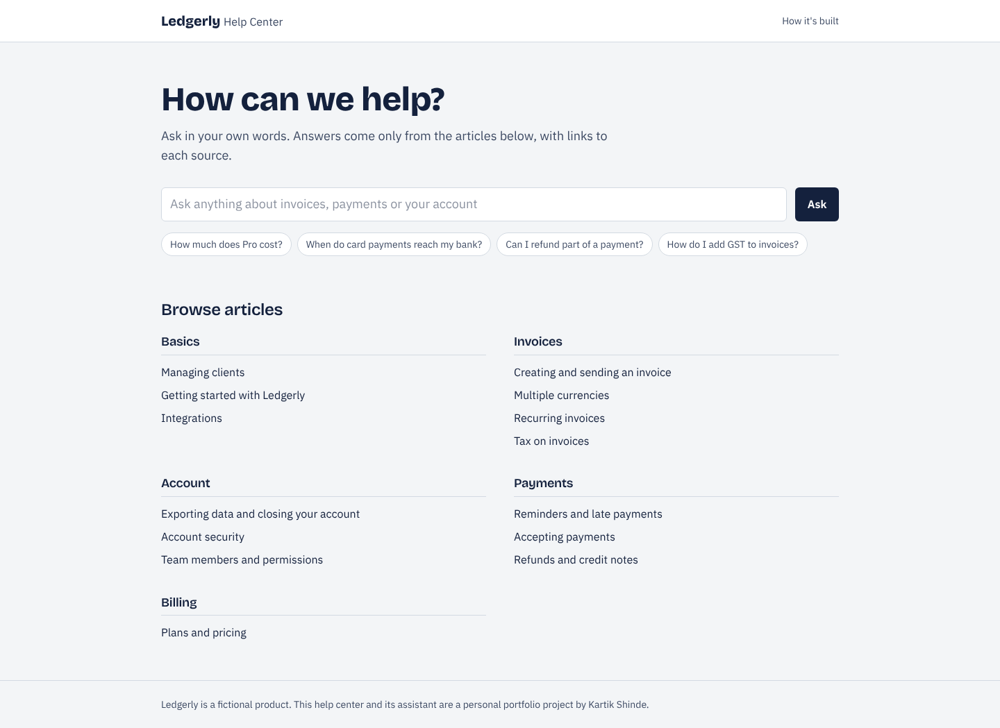

# Answerdesk: an AI help-center assistant that cites its sources

Visitors ask questions in their own words and get short answers drawn **only** from the help articles, with numbered
citations linking to the exact section. Questions the articles don't cover get an honest "I couldn't find that" instead of a guess.

A **personal portfolio project** by Kartik Shinde. "Ledgerly" and its help articles are fictional, written for this demo.

**Live demo:** https://answerdesk-one.vercel.app



## How it works

1. **Search runs locally.** Each article section is embedded with a small open-source model (all-MiniLM-L6-v2, Apache-2.0)
   that ships with the app. Embeddings live in Postgres with pgvector. No API key is needed for search.
2. **No answer without evidence.** If the best match is below a similarity threshold, the app replies "not found" and never calls the language model.
3. **Grounded generation.** Otherwise the top 4 distinct sections are numbered and sent to a small, low-cost model with instructions to answer
   only from them and cite `[1]`, `[2]`. The answer streams in; citations become links to the article section.
4. **Cost and abuse limits in the database.** Each visitor gets 15 questions a day and the whole site 300, enforced by a Postgres function with
   row locking so concurrent requests can't overshoot. Visitors are identified by a daily-rotating hash, never a stored IP address.
5. **Works with or without a model.** If the language model is unavailable or not enabled, the assistant quotes the best-matching
   section with its citation instead of failing. The public demo runs in this no-cost mode; enabling the AI Gateway switches it to generated answers with no code change.

| Concern | Where |
| --- | --- |
| Article parsing and chunking | `src/lib/content.ts` |
| Local embeddings | `src/lib/embed.ts`, `scripts/build-index.mts` |
| Answer policy and prompt | `src/lib/answer.ts` |
| API route | `src/app/api/ask/route.ts` |
| Database, search function and usage limits | `supabase/migrations/0001_answerdesk.sql` |

## Tests

```bash
npm test          # unit tests: parsing, chunking, answer policy, prompt, input limits, visitor hashing
npm run test:db   # 8 database checks: locked tables, search ranking, per-visitor and site-wide limits, no raw IPs
npm run eval      # retrieval quality: 13 real questions find the right article, 2 off-topic ones are rejected (15/15)
npm run test:e2e  # browser tests on desktop and mobile
npm run type-check && npm run lint && npm run build
```

## Run it yourself

1. Create a Supabase project and run `supabase/migrations/0001_answerdesk.sql`.
2. `npm install --legacy-peer-deps && npm run index`, then run `supabase/seed/chunks.sql` in the SQL editor.
3. Copy `.env.example` to `.env.local` with your Supabase URL and publishable key.
4. Answers use the Vercel AI Gateway. On Vercel it authenticates automatically; locally set `AI_GATEWAY_API_KEY`.

To change the help content, edit the Markdown files in `content/` and rerun `npm run index`.

## Stack

Next.js 16 (App Router, route handlers), React 19, TypeScript, Tailwind CSS, Supabase Postgres with pgvector, Transformers.js, AI SDK with Vercel AI Gateway, Zod, Vitest, Playwright.
